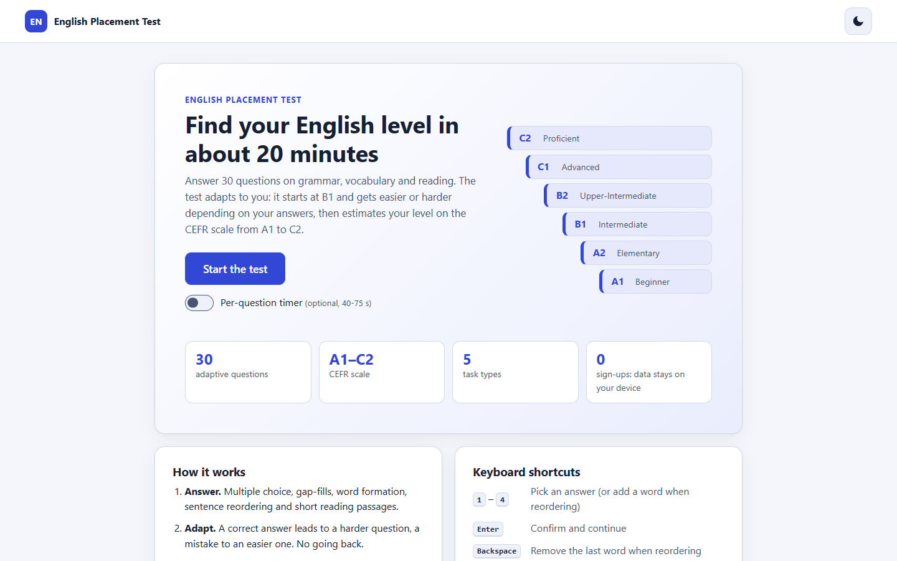
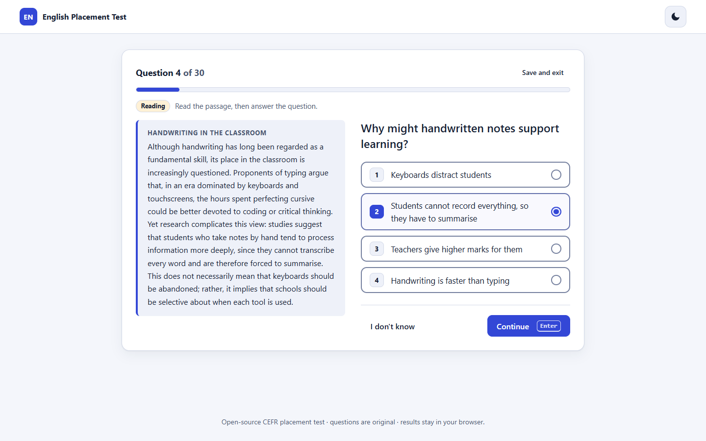
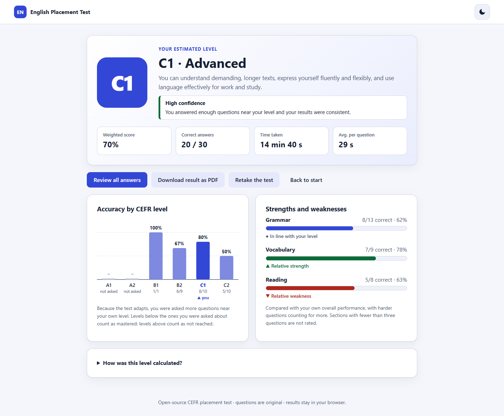
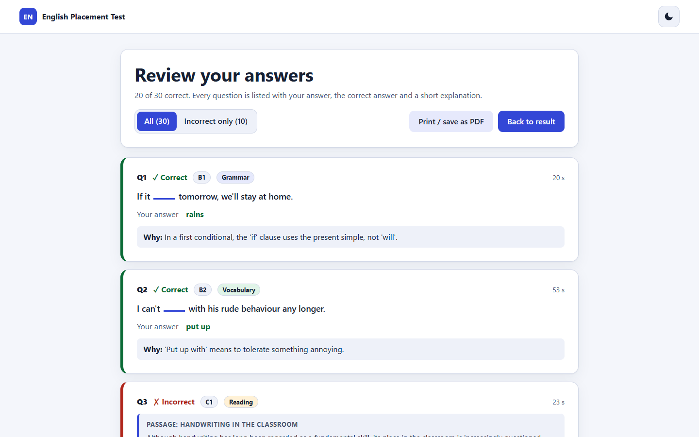

# English Placement Test

An adaptive English placement test that estimates a learner's level on the CEFR scale (A1 to C2). Thirty questions are drawn from an original bank of 102, the difficulty follows the learner's answers, and the result page shows a per-level breakdown, strengths and weaknesses, and a full review with explanations.

It is plain HTML, CSS and JavaScript (ES modules): no build step, no dependencies, no backend. Everything, including progress and history, stays in the browser.

**[Live demo](https://arifaydin12.github.io/english-assessment/)**

| Start screen | Question |
| --- | --- |
|  |  |
| **Result** | **Review** |
|  |  |

## Features

**Test**
- 102 original questions, at least 15 per CEFR level, in five task types: multiple choice, fill in the blank (with alternative accepted answers), word formation, sentence reordering and short reading passages (12 passages, 2-3 questions each).
- Adaptive flow: 30 questions per session, drawn at random, starting at B1 and moving up or down with performance, with a per-level cap to keep the mix balanced.
- Optional per-question timer (40-75 s depending on the task).
- Result: estimated level, level-weighted score, a confidence rating, time taken, an accessible per-level bar chart (SVG), strengths and weaknesses for grammar, vocabulary and reading.
- Review screen listing every question with your answer, the correct answer and an explanation; can be filtered to mistakes only.

**Experience**
- Keyboard use: `1`-`4` pick an answer (or add a word when reordering), `Enter` continues, `Backspace` removes the last reordered word.
- Progress is saved after every answer; a "Resume" card appears on the start screen. A history of previous results and the last review are stored in `localStorage`.
- Retake button, dark/light theme (follows the system, remembers your choice).
- "Download result as PDF" uses `window.print()` with a dedicated print stylesheet (the result page and the review both print cleanly).
- Responsive from 360 px to 1920 px; visible focus states, `aria-live` announcements for validation and the timer, `prefers-reduced-motion` respected, colours checked for WCAG AA contrast.

## How the level is estimated

1. **Per-level accuracy.** Answers are grouped by the question's CEFR level. Accuracy at each level is corrected for blind guessing: with `c` the chance of guessing right (25 % for a 4-option question, 0 for typed answers), the corrected accuracy is `(p - c) / (1 - c)`, limited to 0-1.
2. **Levels that were not asked** (the test adapts, so a strong learner may never see A1) are imputed: levels below the lowest asked level count as mastered (1.0), levels above the highest asked level as not reached (0.0), and gaps in between are the average of their neighbours.
3. **Weighted score.** `S = sum(w(L) * p(L)) / sum(w)` with weights A1 = 1, A2 = 2, B1 = 3, B2 = 4, C1 = 5, C2 = 6, so harder levels count more.
4. **Thresholds.** A level is reached when every lower level is mastered and at least 60 % (`PASS_RATIO`) of that level is answered correctly. The cut-off for level `k` is `T(k) = (sum of weights below k + 0.6 * w(k)) / 21`:

   | Level | Cut-off score |
   | --- | --- |
   | A1 | 2.9 % |
   | A2 | 10.5 % |
   | B1 | 22.9 % |
   | B2 | 40.0 % |
   | C1 | 61.9 % |
   | C2 | 88.6 % |

   The estimate is the highest level whose cut-off the score reaches; below the A1 cut-off the result is "Below A1".
5. **Confidence** (high / medium / low) from up to 6 points: number of answers (0-2), answers at the estimated level and the next one (0-2), distance from the nearest cut-off (0-1) and consistency across neighbouring levels (0-1). 5 or more is high, 3-4 medium, otherwise low. A result below A1 is capped at low because the bank cannot measure lower.
6. **Strengths and weaknesses.** Each category gets a level-weighted, guess-corrected accuracy that is compared with the learner's overall figure: +10 points or more is a relative strength, -10 or less a relative weakness. Categories with fewer than three questions are not rated.

**Adaptive flow.** After each question (or each reading passage, which is served as one block) the target level moves up when at least two thirds were correct and down when a third or fewer were; otherwise it stays. The next question comes from the target level, or from the nearest level when that level already supplied 10 questions, and the category is chosen to track a 45 % grammar / 30 % vocabulary / 25 % reading mix. All randomness is seeded per session, so a resumed session continues exactly as it would have.

All parameters live in [`js/config.js`](js/config.js) and [`js/scoring.js`](js/scoring.js).

**How reliable is it?** The unit tests include a simulation of virtual learners with known levels. With the current settings, simulated learners are placed within one level of their true level in roughly 98 % of runs, and exactly on it in about 73-97 % of runs depending on the level. That checks the algorithm, not the content: the questions have not been calibrated against real learners, so treat the result as a quick estimate, not a certificate.

## Run locally

The questions are loaded with `fetch`, so serve the folder over HTTP rather than opening `index.html` directly:

```bash
npx serve .
# or
python -m http.server 8000
```

## Tests and validation

Requires Node.js 18 or newer. There are no dependencies to install.

```bash
npm test          # unit tests (node:test): scoring, adaptive flow, session state, storage, question bank
npm run validate  # schema check of questions.json
```

`scripts/validate-questions.js` checks: unique ids, ids matching their level, valid level/category/type, `correct_answer` present exactly once in `answers`, a single `___` blank in typed questions, reorder questions using exactly the words given (4-9 tokens), reading questions pointing to an existing passage of the same level, 2-3 questions per passage, non-empty explanations, at least 15 questions per level with every task type present at every level, and no characters outside English text and basic punctuation.

## Adding questions

Edit [`questions.json`](questions.json) (`{ "version", "passages": [...], "questions": [...] }`), run `npm run validate`, then `npm test`. Increase `version` when you change the bank in a way that should invalidate saved sessions.

```json
{ "id": "b1-18", "level": "B1", "category": "grammar", "type": "multiple-choice",
  "question": "I've lived here ___ 2015.", "answers": ["for", "since", "from"],
  "correct_answer": "since", "explanation": "Use 'since' with a point in time." }
```

| Field | Notes |
| --- | --- |
| `id` | `<level in lower case>-<two digits>`, unique |
| `level` | `A1` ... `C2` |
| `category` | `grammar`, `vocabulary` or `reading` |
| `type` | `multiple-choice` (3-4 `answers`, shuffled per session), `fill-in-the-blank` (one `___` in `question`), `word-formation` (adds an uppercase `base` word), `reorder` (`words` as a jumbled array, `correct_answer` as the sentence) |
| `correct_answer` | The answer, or the full sentence for `reorder` |
| `accepted_answers` | Optional alternatives for typed and reorder questions. Matching ignores case, extra spaces, curly quotes and trailing punctuation |
| `passage` | Reading only: id of an entry in `passages` (`{ "id": "p-b1-3", "level", "title", "text" }`). Give each passage 2-3 questions with `category: "reading"` |
| `explanation` | Short, shown in the review (max 220 characters) |

Write questions that have exactly one defensible answer, and add every acceptable alternative to `accepted_answers`.

## Project structure

```
index.html            page shell (theme is applied before first paint)
css/styles.css        design tokens, light/dark themes, components, print styles
js/app.js             controller: screens, timer, keyboard shortcuts
js/state.js           session state machine (plain JSON, resumable)
js/adaptive.js        staircase and question selection
js/scoring.js         answer checking, level weights, thresholds, confidence (pure functions)
js/storage.js         localStorage wrapper (theme, session, history)
js/ui.js              DOM rendering
js/config.js          test length, timing, limits
js/rng.js             seeded random numbers
questions.json        question bank
scripts/              validate-questions.js
test/                 node:test suites
docs/                 screenshots
```

## License

MIT. See [LICENSE](LICENSE).
